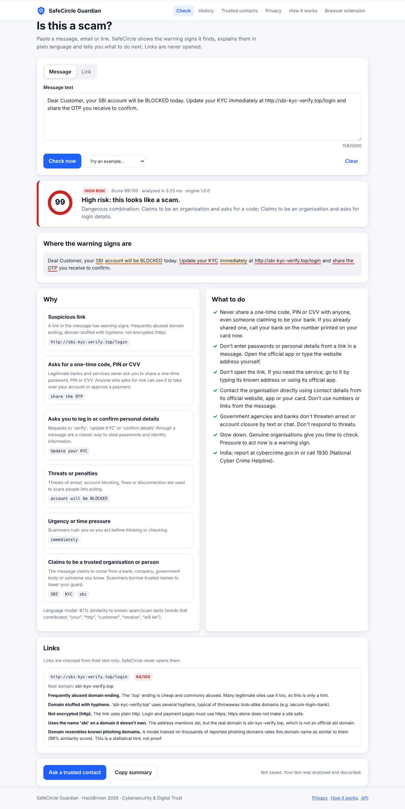
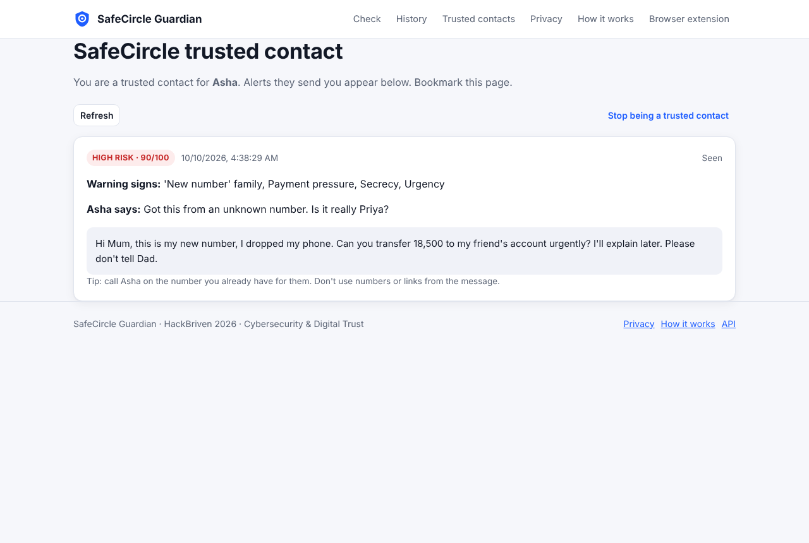

# SafeCircle Guardian

**Detects how a UPI, banking or wallet scam unfolds across several events, explains its evidence, warns at the
right moment, and links related scam campaigns.**
HackBriven 2026 · IIT Delhi Problem Statement 02: AI-driven scam pattern recognition.

| | |
|---|---|
|  |  |

## What works today

- **Scam DNA** (`/cases/`): an investigation per suspicious episode. Add messages, call notes, links and screenshots
  as they arrive; each one re-evaluates the case. An interactive attack chain shows observed evidence, the tactics it
  supports and the inferred stage progression (Approach → Pressure → Harvest → Control → Extraction), with
  "what changed", missing and conflicting evidence, uncertainty, review state and stage-aware advice.
- **Scam Forensics** (`/forensics/`): one report for a message, a "Name: message" conversation, a link (never
  opened) or a screenshot read **locally with Tesseract** (image never stored). Says whether the analysis was
  completed, partial or unavailable, and can feed its findings into a case.
- **Campaign Radar** (`/campaigns/`): groups your cases that share a domain, link, UPI handle or phone (compared as
  hashes), a link-path pattern or near-identical wording. Exact matches and similarity are shown separately, with
  uncertainty, and any relationship can be dismissed.
- **UPI Scam Guard** (`/upi/`): check a UPI ID or a payment QR before paying. The QR is decoded in the browser.
  It flags pay-to-receive tricks, refund/KYC/"customer care" payees and handles already seen in your risky cases.
  It never sees, blocks or approves a real payment, and it consults no bank or NPCI data.
- **Evidence report** (case → *Evidence report*): a reviewable report of the redacted evidence, timeline, reasoning,
  indicators, related cases and uncertainty, exported as PDF (print), Markdown or JSON. It is never sent anywhere.
- **Scam network** (`/network/`): graph of cases and the domains, UPI IDs, hashed phones and claimed organisations
  they share. Observed links are solid; Campaign Radar similarity is dashed.
- **Alert de-duplication**: unchanged evidence is suppressed; alerts fire only when risk rises or a new high-weight
  tactic appears; every decision (including suppressions) is in the case's audit trail.
- **Guardian Shield** (Chrome MV3 extension): check links and selected text; risky links get a warning page with
  *Go back* and an explicit, acknowledged override; optional link guard checks links you click before they open;
  honest "Not checked" states for timeouts and outages.
- **Overview**: metrics computed from your own cases (investigations, open, needing review, campaigns, alerts,
  suppressed duplicates) with DEMO DATA counts labelled, plus recent decisions. The 3D globe stays, labelled as demo.
- **Demo mode**: five synthetic, labelled scenarios (benign notification, KYC suspension, UPI collect, multi-stage
  impersonation, digital arrest) played step by step through the live engine, plus ten synthetic campaign cases.
- From before: message and link analysis (`/analyze/*`) with 12 tactic categories and a local language model,
  trusted contacts with two-sided consent, opt-in history, export and delete-everything, optional AI summary that
  never changes the score.

No paid API, API key or external model is needed. Full description: [docs/scam-dna.md](docs/scam-dna.md) and
[docs/advanced-features.md](docs/advanced-features.md) (including the feature-gap assessment).

## Measured results

### Scam DNA (synthetic scenarios, not a real-world measurement)

30 synthetic scenarios (12 benign, 18 scams) in `evaluation/scam_dna/`. Initial run: precision 0.800, recall 0.889,
false-positive rate 0.333. After fixing the four issues that run exposed: precision 0.944, recall 0.944, FPR 0.083.
The second figure is not independent (the fixes were informed by the same set) and both were written by the team
that wrote the rules. Details and remaining errors: [evaluation/scam_dna/README.md](evaluation/scam_dna/README.md).

### Message and link detector (held-out public data, reproducible; detector unchanged by the upgrade)

| Setting | Precision | Recall | F1 | FPR |
|---|---|---|---|---|
| Messages, full detector (score ≥ 30) | 0.947 | 0.953 | 0.950 | 0.83% |
| Messages, full detector (score ≥ 60) | 1.000 | 0.638 | 0.779 | 0.00% |
| Links, rules + domain model (full URL) | 0.951 | 0.634 | 0.761 | 3.26% |
| Links, rules + domain model (hostname only) | 0.949 | 0.609 | 0.742 | 3.26% |

Messages: SMS Spam Collection test split (1,115 messages). Links: 5,000 reported phishing URLs vs 5,000 popular
hostnames. Median analysis time 0.69 ms per message (in-process). Full details, baselines and limitations in
[docs/methodology.md](docs/methodology.md) and [evaluation/results/metrics.json](evaluation/results/metrics.json).

## Quick start (local)

Requirements: Python 3.11+ (tested on 3.13), Node 20+ (tested on 22).

```bash
# OCR for screenshots (optional; without it screenshots are reported as "unavailable")
brew install tesseract               # macOS; Debian/Ubuntu: apt-get install tesseract-ocr

# Backend
cd backend
python -m venv .venv && . .venv/bin/activate
pip install -r requirements-dev.txt
alembic upgrade head                 # creates/updates safecircle.db (SQLite)
uvicorn app.main:app --reload        # http://localhost:8000/api/docs

# Frontend (second terminal)
cd frontend
npm ci
NEXT_PUBLIC_API_BASE=http://localhost:8000 npm run dev   # http://localhost:3000
```

Single-process mode (what production runs and what the demo uses): `cd frontend && npm run build`, then
`cd backend && SAFECIRCLE_STATIC_DIR=../frontend/out uvicorn app.main:app --host 127.0.0.1 --port 8000` and open
**http://127.0.0.1:8000** (use the same host name the build's `NEXT_PUBLIC_API_BASE` points at, if one is set).

Browser extension: open `chrome://extensions`, enable Developer mode, **Load unpacked** → `extension/`. Its default
server is `http://127.0.0.1:8000`; change it, the timeout or the optional link guard in the extension's Options.

With Docker: `SAFECIRCLE_SECRET_KEY=$(openssl rand -hex 32) docker compose up --build` (app + PostgreSQL).

## Tests

```bash
cd backend && python -m pytest -q                      # 152 unit/API tests (SQLite); OCR tests skip without Tesseract
SAFECIRCLE_TEST_DATABASE_URL=postgresql+psycopg2://... python -m pytest -q   # same suite on PostgreSQL
node --test extension/tests/                           # 18 extension tests (3 need a running server)
cd e2e && npm i
BASE_URL=http://127.0.0.1:8000 CHROMIUM=/path/to/chrome node e2e.mjs              # 18 original browser checks
BASE_URL=http://127.0.0.1:8000 CHROMIUM=/path/to/chrome node scamdna.mjs          # 21 Scam DNA / Forensics / Radar checks
BASE_URL=http://127.0.0.1:8000 CHROMIUM=/path/to/chrome node extension-pages.mjs  # 17 Guardian Shield page checks
BASE_URL=http://127.0.0.1:8000 CHROMIUM=/path/to/chrome node advanced.mjs         # 30 UPI Guard / report / network checks
python evaluation/scam_dna/evaluate_scam_dna.py         # synthetic scenario evaluation
python evaluation/evaluate.py --benign-hosts <file>   # detector evaluation, see evaluation/README.md
```

## Repository map

```
backend/        FastAPI app, detector, models, Alembic migrations, tests
  app/detector/ normalize.py, rules.py, url_analyzer.py, ml.py, engine.py, models/ (trained artifacts)
  app/scamdna/  tactics, evidence redaction, case assessment, alerts, campaigns, OCR, demo fixtures,
                upi (UPI Guard), report (evidence report), network (graph)
frontend/       Next.js 15 + TypeScript dashboard (static export served by the API)
extension/      Chrome/Edge Manifest V3 extension
evaluation/     training + evaluation scripts, datasets, results; scam_dna/ synthetic scenario evaluation
e2e/            Playwright end-to-end and extension tests
docs/           architecture, API, threat model, privacy, deployment, methodology, screenshots
paper/          research paper (.docx, editable)    slides/  presentation (.pptx, editable)
```

## Documentation

[Scam DNA & features](docs/scam-dna.md) · [UPI Guard, report, network](docs/advanced-features.md) · [Architecture](docs/architecture.md) · [API](docs/api.md) · [Threat model](docs/threat-model.md) ·
[Privacy](docs/privacy.md) · [Deployment](docs/deployment.md) · [Methodology & evaluation](docs/methodology.md) ·
[Project status](STATUS.md) · [Security policy](SECURITY.md)

## What SafeCircle does not do

It does not read your SMS, WhatsApp, email or calls, and it does not monitor UPI or bank transactions. Mobile platforms restrict that access (for example, Google Play only
allows SMS/Call Log permissions for default handler apps), and we do not try to get around it. You choose what to check.
No detector is perfect: a low score is not a guarantee. Risk scores are heuristic indicators from transparent rules,
not calibrated probabilities of fraud. No legal, regulatory or banking certification has been obtained.

## Licence

MIT. Datasets keep their own licences (see [LICENSE](LICENSE)).
